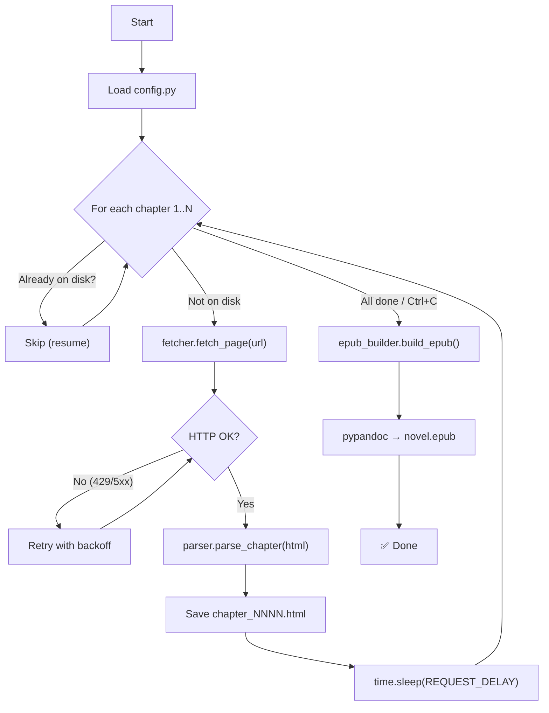

# 📖 LoLoBun Web Novel Scraper → EPUB — Implementation Plan

## Overview

A Python CLI tool that scrapes chapters from `lolobun.com`, cleans the HTML, and assembles them into a well-structured EPUB using Pandoc.

---

## 1. URL Scheme & Chapter ID Logic

The chapter URLs follow a **descending** numeric pattern:

| Chapter | URL |
|---------|-----|
| 1 | `https://www.lolobun.com/n/5320155/7173977` |
| 2 | `https://www.lolobun.com/n/5320155/7173976` |
| 3 | `https://www.lolobun.com/n/5320155/7173975` |
| N | `https://www.lolobun.com/n/5320155/{7173978 - N}` |

```
BASE_URL = "https://www.lolobun.com/n/5320155"
FIRST_CHAPTER_ID = 7173977

def chapter_url(chapter_number: int) -> str:
    return f"{BASE_URL}/{FIRST_CHAPTER_ID - chapter_number + 1}"
```

> [!IMPORTANT]
> The novel ID (`5320155`) and first chapter ID (`7173977`) should be configurable constants so the tool can be reused for other novels on the same site.

---

## 2. Project Structure

```
lolobun-scraper/
├── scraper.py          # Main entry point & orchestration
├── config.py           # All user-configurable constants
├── fetcher.py          # HTTP fetching with retries & rate limiting
├── parser.py           # BeautifulSoup HTML parsing & cleaning
├── epub_builder.py     # Pandoc/pypandoc EPUB assembly
├── requirements.txt    # Python dependencies
├── output/
│   ├── chapters/       # Individual chapter HTML/MD files (intermediate)
│   └── novel.epub      # Final EPUB output
└── README.md
```

---

## 3. Configuration (`config.py`)

All user-tunable knobs live here as module-level globals:

```python
# ── Novel identity ──────────────────────────────────────
NOVEL_ID        = "5320155"
FIRST_CHAPTER_ID = 7173977
BASE_URL        = f"https://www.lolobun.com/n/{NOVEL_ID}"

# ── Scraping controls ──────────────────────────────────
NUM_CHAPTERS    = 50          # How many chapters to fetch
REQUEST_DELAY   = 2.0         # Seconds between requests (rate limit)
REQUEST_TIMEOUT = 15          # Seconds before a request times out
MAX_RETRIES     = 3           # Retry count on transient failures
RETRY_BACKOFF   = 5.0         # Seconds to wait before retrying

# ── Output ──────────────────────────────────────────────
OUTPUT_DIR      = "output"
CHAPTERS_DIR    = "output/chapters"
EPUB_FILENAME   = "novel.epub"

# ── Book metadata (for EPUB) ────────────────────────────
BOOK_TITLE      = "My Web Novel"
BOOK_AUTHOR     = "Unknown Author"
BOOK_LANGUAGE   = "en"

# ── HTTP headers ────────────────────────────────────────
USER_AGENT = (
    "Mozilla/5.0 (Windows NT 10.0; Win64; x64) "
    "AppleWebKit/537.36 (KHTML, like Gecko) "
    "Chrome/120.0.0.0 Safari/537.36"
)
```

> [!TIP]
> Consider also adding a `START_CHAPTER` constant (default `1`) so the user can resume a partially-completed scrape without re-downloading everything.

---

## 4. Module-by-Module Design

### 4.1 `fetcher.py` — HTTP Fetching

**Responsibilities:**
- Send GET requests with a realistic `User-Agent`
- Respect `REQUEST_DELAY` between calls
- Retry on transient HTTP errors (429, 5xx) with exponential backoff
- Return raw HTML or raise after `MAX_RETRIES`

```python
import time
import requests
from config import (
    USER_AGENT, REQUEST_TIMEOUT, MAX_RETRIES, RETRY_BACKOFF, REQUEST_DELAY
)

session = requests.Session()
session.headers.update({"User-Agent": USER_AGENT})

def fetch_page(url: str) -> str:
    """Fetch a single page, returning its HTML. Retries on failure."""
    for attempt in range(1, MAX_RETRIES + 1):
        try:
            resp = session.get(url, timeout=REQUEST_TIMEOUT)
            resp.raise_for_status()
            resp.encoding = "utf-8"        # force UTF-8 decoding
            return resp.text
        except requests.exceptions.HTTPError as e:
            status = e.response.status_code if e.response else None
            if status in (429, 500, 502, 503, 504) and attempt < MAX_RETRIES:
                wait = RETRY_BACKOFF * attempt
                print(f"  ⚠ HTTP {status}, retrying in {wait}s (attempt {attempt}/{MAX_RETRIES})")
                time.sleep(wait)
            else:
                raise
        except requests.exceptions.ConnectionError:
            if attempt < MAX_RETRIES:
                time.sleep(RETRY_BACKOFF * attempt)
            else:
                raise
    raise RuntimeError(f"Failed to fetch {url} after {MAX_RETRIES} attempts")
```

> [!NOTE]
> A `requests.Session` is used to persist TCP connections and cookies, which is both faster and looks more natural to the server.

---

### 4.2 `parser.py` — HTML Parsing & Cleaning

**Responsibilities:**
- Extract the chapter title from `div.title`
- Extract the chapter body from `div.text-content-box` (all child `<p>` elements)
- Normalize the chapter number from the title string (handle irregular formats)
- Strip ads, scripts, styles, and other non-content elements
- Return a structured `Chapter` dataclass

```python
import re
from dataclasses import dataclass
from bs4 import BeautifulSoup

@dataclass
class Chapter:
    number: int           # Ordinal position (1, 2, 3, …)
    raw_title: str        # The full title string from the page
    display_title: str    # Cleaned title for the EPUB heading
    body_html: str        # Cleaned HTML content (the <p> elements)

def parse_chapter(html: str, ordinal: int) -> Chapter:
    """Parse a chapter page and return a Chapter object."""
    soup = BeautifulSoup(html, "html.parser")

    # ── Title extraction ────────────────────────────────
    title_el = soup.select_one("div.title")
    raw_title = title_el.get_text(strip=True) if title_el else f"Chapter {ordinal}"

    # Normalize: the title may be "Chapter 1: After Defeat..."
    # or just "2 You're Awake?..." — we unify them.
    display_title = normalize_title(raw_title, ordinal)

    # ── Body extraction ─────────────────────────────────
    content_el = soup.select_one("div.text-content-box")
    if not content_el:
        raise ValueError(f"Chapter {ordinal}: could not find div.text-content-box")

    # Remove unwanted nested elements
    for junk in content_el.select("script, style, .ads, .ad-banner, nav, footer, iframe"):
        junk.decompose()

    # Collect only <p> tags for clean prose
    paragraphs = content_el.find_all("p")
    body_html = "\n".join(str(p) for p in paragraphs)

    return Chapter(
        number=ordinal,
        raw_title=raw_title,
        display_title=display_title,
        body_html=body_html,
    )


def normalize_title(raw: str, ordinal: int) -> str:
    """
    Handle inconsistent title formats:
      "Chapter 1: After Defeat and Capture, Som"  →  "Chapter 1: After Defeat and Capture, Som"
      "2 You're Awake? You're a Dad Now!"         →  "Chapter 2: You're Awake? You're a Dad Now!"

    Strategy:
      1. If it already starts with "Chapter <N>", keep it as-is.
      2. If it starts with a bare number, reformat to "Chapter N: <rest>".
      3. Otherwise, prepend "Chapter <ordinal>: ".
    """
    raw = raw.strip()

    # Case 1: Already has "Chapter N" prefix (case-insensitive)
    match_full = re.match(r'^(chapter\s+\d+)', raw, re.IGNORECASE)
    if match_full:
        return raw  # already well-formed

    # Case 2: Starts with a bare number
    match_num = re.match(r'^(\d+)\s*(.*)', raw)
    if match_num:
        num = match_num.group(1)
        rest = match_num.group(2).lstrip(":").strip()
        return f"Chapter {num}: {rest}" if rest else f"Chapter {num}"

    # Case 3: No number at all — use the ordinal
    return f"Chapter {ordinal}: {raw}"
```

> [!WARNING]
> The title normalization regex is based on the two known formats you described. During implementation, we should log any titles that don't match either pattern so we can add handling for edge cases.

---

### 4.3 `epub_builder.py` — EPUB Assembly via Pandoc

**Responsibilities:**
- Take the list of `Chapter` objects
- Write each chapter as a separate intermediate HTML file (for Pandoc's multi-file input)
- Invoke Pandoc (via `pypandoc`) to stitch them into a single EPUB3
- Include a Table of Contents, metadata, and optionally a cover image

**Two approaches are available:**

#### Approach A — Multi-file input (Recommended)

Each chapter becomes its own `.html` file. Pandoc combines them into one EPUB with automatic chapter splitting.

```python
import os
import pypandoc
from config import (
    CHAPTERS_DIR, OUTPUT_DIR, EPUB_FILENAME,
    BOOK_TITLE, BOOK_AUTHOR, BOOK_LANGUAGE,
)

def save_chapter_file(chapter, output_dir: str) -> str:
    """Write a single chapter to an HTML file. Returns the file path."""
    os.makedirs(output_dir, exist_ok=True)
    filename = f"chapter_{chapter.number:04d}.html"
    filepath = os.path.join(output_dir, filename)

    html = f"""<!DOCTYPE html>
<html lang="{BOOK_LANGUAGE}">
<head><meta charset="UTF-8"></head>
<body>
<h1>{chapter.display_title}</h1>
{chapter.body_html}
</body>
</html>"""

    with open(filepath, "w", encoding="utf-8") as f:
        f.write(html)
    return filepath


def build_epub(chapters, cover_image: str = None):
    """Compile all chapter files into a single EPUB."""
    # 1. Write each chapter to disk
    chapter_files = []
    for ch in chapters:
        path = save_chapter_file(ch, CHAPTERS_DIR)
        chapter_files.append(path)

    # 2. Build pandoc arguments
    extra_args = [
        "--toc",
        "--toc-depth=1",
        "--epub-chapter-level=1",
        f"--metadata=title:{BOOK_TITLE}",
        f"--metadata=author:{BOOK_AUTHOR}",
        f"--metadata=lang:{BOOK_LANGUAGE}",
    ]
    if cover_image and os.path.exists(cover_image):
        extra_args.append(f"--epub-cover-image={cover_image}")

    # 3. Invoke pandoc
    output_path = os.path.join(OUTPUT_DIR, EPUB_FILENAME)
    os.makedirs(OUTPUT_DIR, exist_ok=True)

    pypandoc.convert_file(
        chapter_files,        # list of files
        to="epub3",
        outputfile=output_path,
        extra_args=extra_args,
    )

    print(f"\n✅ EPUB saved to: {output_path}")
    return output_path
```

#### Approach B — Single concatenated HTML (Simpler alternative)

All chapters are concatenated into one large HTML string, with `<h1>` tags triggering chapter breaks. This is simpler but gives you less control over intermediate files.

> [!TIP]
> **Approach A is recommended** because it lets you resume a partial scrape — you can check which `chapter_NNNN.html` files already exist and skip re-downloading them.

---

### 4.4 `scraper.py` — Main Orchestrator

**Responsibilities:**
- Iterate from chapter 1 to `NUM_CHAPTERS`
- Compute each chapter's URL
- Call `fetcher.fetch_page()` → `parser.parse_chapter()`
- Respect `REQUEST_DELAY` between requests
- Display a progress bar / status log
- On completion, call `epub_builder.build_epub()`
- Handle graceful interruption (Ctrl+C saves progress)

```python
import os
import sys
import time
from config import (
    BASE_URL, FIRST_CHAPTER_ID, NUM_CHAPTERS, REQUEST_DELAY,
    CHAPTERS_DIR, START_CHAPTER,
)
from fetcher import fetch_page
from parser import parse_chapter
from epub_builder import build_epub, save_chapter_file

def chapter_url(chapter_number: int) -> str:
    chapter_id = FIRST_CHAPTER_ID - chapter_number + 1
    return f"{BASE_URL}/{chapter_id}"

def already_downloaded(chapter_number: int) -> bool:
    """Check if a chapter file already exists (for resume support)."""
    path = os.path.join(CHAPTERS_DIR, f"chapter_{chapter_number:04d}.html")
    return os.path.exists(path)

def main():
    chapters = []
    start = getattr(__import__('config'), 'START_CHAPTER', 1)

    print(f"📚 Scraping {NUM_CHAPTERS} chapters starting from chapter {start}…\n")

    try:
        for i in range(start, start + NUM_CHAPTERS):
            url = chapter_url(i)

            # Skip if already downloaded (resume support)
            if already_downloaded(i):
                print(f"  ⏭  Chapter {i} already exists, skipping.")
                # Still need to parse for the EPUB assembly later
                continue

            print(f"  [{i}/{start + NUM_CHAPTERS - 1}] Fetching {url}…", end=" ")
            html = fetch_page(url)
            chapter = parse_chapter(html, ordinal=i)
            chapters.append(chapter)
            save_chapter_file(chapter, CHAPTERS_DIR)  # persist immediately
            print(f"✓ {chapter.display_title}")

            # Rate-limit delay (skip after last chapter)
            if i < start + NUM_CHAPTERS - 1:
                time.sleep(REQUEST_DELAY)

    except KeyboardInterrupt:
        print(f"\n\n⚠ Interrupted after {len(chapters)} chapters.")
        if chapters:
            print("  Building EPUB with chapters fetched so far…")

    # Re-read all chapter files for final assembly (handles resume case)
    # ... (load from disk and build)

    if chapters:
        build_epub(chapters)
    else:
        print("No new chapters to process.")

if __name__ == "__main__":
    main()
```

---

## 5. Execution Flow



---

## 6. Dependencies

### `requirements.txt`
```
requests>=2.31
beautifulsoup4>=4.12
pypandoc>=1.13
```

### System dependency
- **Pandoc** must be installed separately:
  - Windows: `winget install --id JohnMacFarlane.Pandoc` or download from [pandoc.org](https://pandoc.org/installing.html)
  - Or install via pypandoc: `pypandoc.download_pandoc()`

---

## 7. Additional Features Worth Adding

| Feature | Priority | Notes |
|---------|----------|-------|
| **Resume support** | 🔴 High | Skip chapters whose files already exist on disk |
| **Progress bar** (`tqdm`) | 🟡 Medium | `tqdm` wrapping the chapter loop for visual progress |
| **CLI arguments** (`argparse`) | 🟡 Medium | Override `NUM_CHAPTERS`, `REQUEST_DELAY`, `START_CHAPTER` from the command line without editing `config.py` |
| **Logging** | 🟡 Medium | Use Python `logging` module instead of bare `print()` for better debugging |
| **Graceful Ctrl+C** | 🔴 High | Catch `KeyboardInterrupt`, build EPUB from what's been fetched so far |
| **Validation step** | 🟢 Low | After EPUB creation, run `epubcheck` or open with Calibre to verify |
| **Custom CSS** | 🟢 Low | A `styles.css` passed to Pandoc for better e-reader typography |
| **Cover image** | 🟢 Low | Pass `--epub-cover-image` to Pandoc if one is provided |
| **JS-rendered fallback** | 🟢 Low | If `requests` gets empty content, fall back to Playwright/Selenium |

---

## 8. Risks & Mitigations

> [!CAUTION]
> **Rate limiting / IP bans**: The site may block aggressive scraping. Mitigations:
> - Default `REQUEST_DELAY` of 2+ seconds
> - Randomize delay slightly (`delay ± 0.5s`) to look less robotic
> - Respect `429 Too Many Requests` headers and back off
> - Use a realistic `User-Agent`

> [!WARNING]
> **Chapter ID exhaustion**: The descending ID pattern may not hold for all novels — some may skip IDs or use non-sequential numbering. The scraper should detect unexpected HTTP 404s and log them rather than silently continuing.

> [!NOTE]
> **Title format edge cases**: The two known formats are `"Chapter N: Title"` and `"N Title"`. If other formats appear (e.g., no number at all, Roman numerals, or "Part X"), the `normalize_title()` function will fall back to using the ordinal position, but a warning should be logged for manual review.

---

## 9. Testing Strategy

1. **Manual smoke test**: Scrape 3 chapters, inspect the intermediate HTML files, verify the EPUB opens correctly in Calibre
2. **Title normalization unit tests**: Feed various title strings into `normalize_title()` and assert the output
3. **Retry logic test**: Mock HTTP 429 responses and verify backoff behavior
4. **Resume test**: Run scraper, interrupt it, run again, verify it skips already-downloaded chapters

---

## 10. Implementation Order

1. ✅ `config.py` — Set up all constants
2. ✅ `fetcher.py` — Get HTTP fetching working with one URL
3. ✅ `parser.py` — Parse a single chapter page, verify selectors
4. ✅ `epub_builder.py` — Generate EPUB from 2-3 test chapters
5. ✅ `scraper.py` — Wire everything together with the main loop
6. ✅ Add resume support & graceful interruption
7. ✅ Add CLI arguments (optional enhancement)
8. ✅ Final testing with a larger batch of chapters
